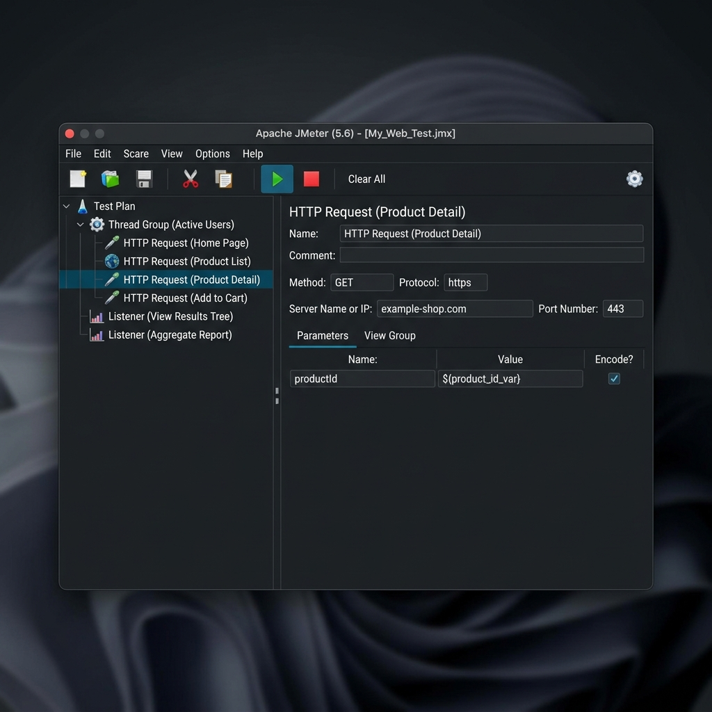
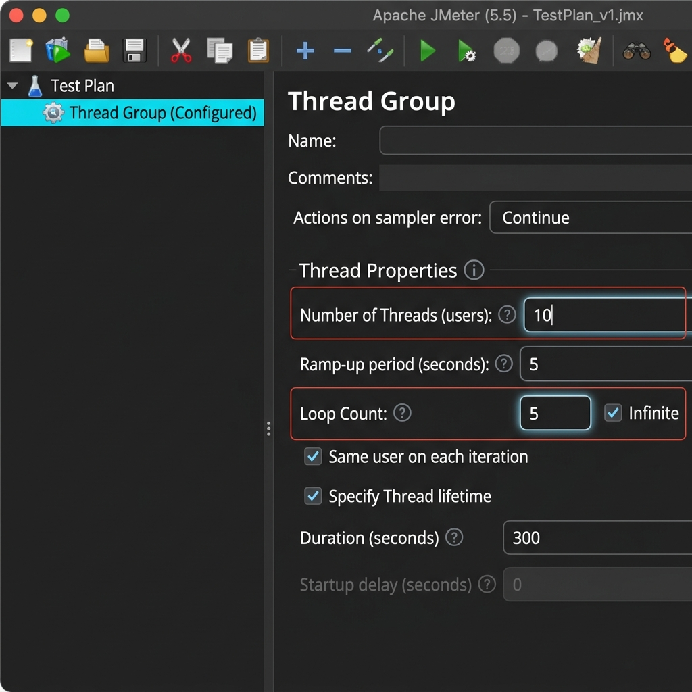
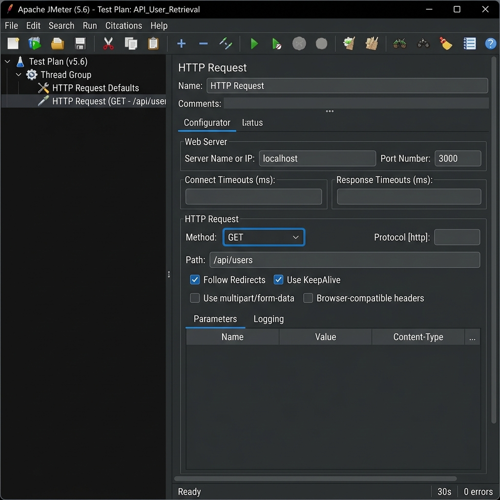
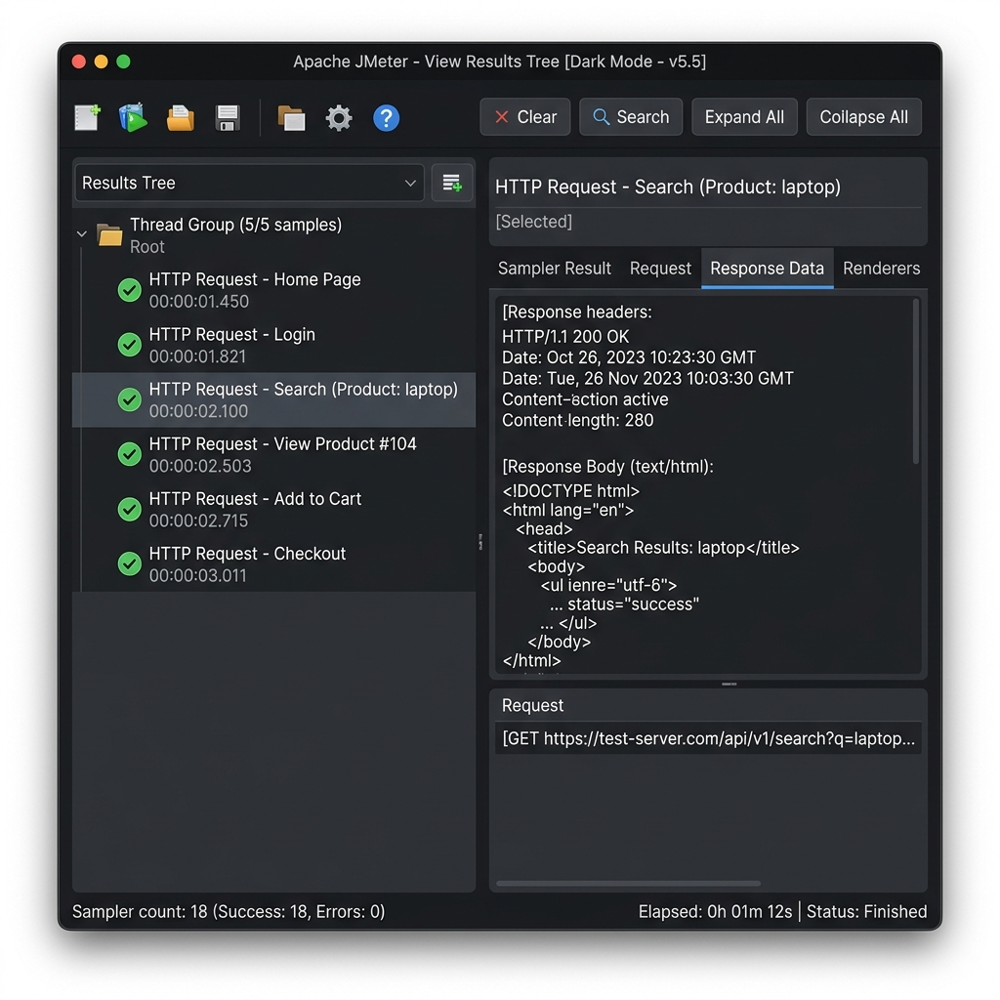
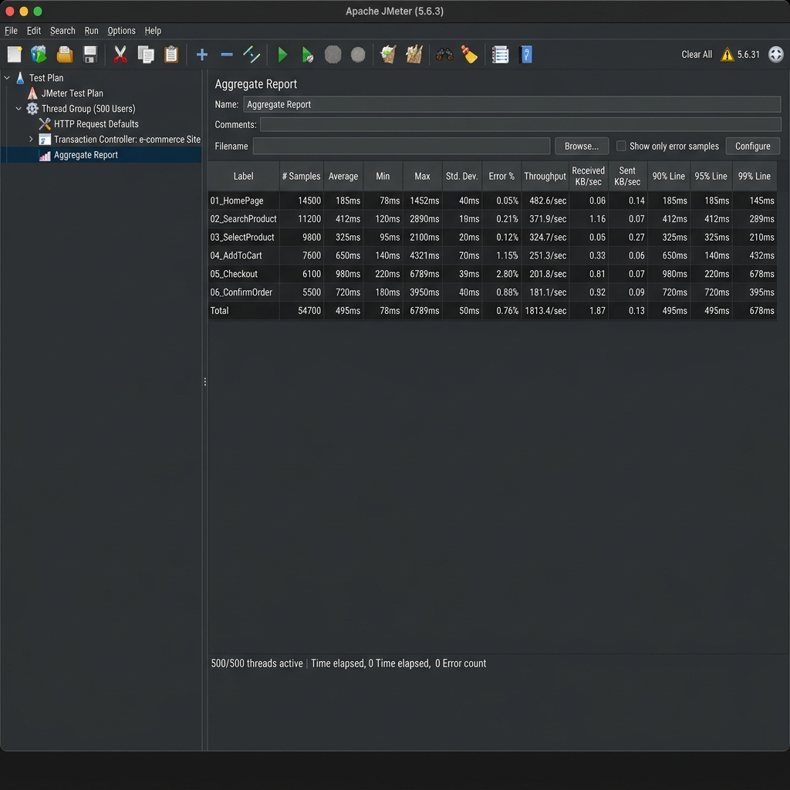

## 📑 Mục lục
1. [Giới thiệu về Apache JMeter](#1-giới-thiệu-về-apache-jmeter)
2. [Hướng dẫn cài đặt môi trường](#2-hướng-dẫn-cài-đặt-môi-trường)
3. [Ứng dụng API mục tiêu (Target API)](#3-ứng-dụng-api-mục-tiêu-target-api)
4. [Thiết lập kịch bản kiểm thử (Test Plan)](#4-thiết-lập-kịch-bản-kiểm-thử-test-plan)
5. [Thực thi và Phân tích kết quả](#5-thực-thi-và-phân-tích-kết-quả)
6. [Các thực hành tốt nhất (Best Practices)](#6-các-thực-hành-tốt-nhất-best-practices)

---

## 1. Giới thiệu về Apache JMeter

**Apache JMeter** là một phần mềm mã nguồn mở hoàn toàn bằng Java, được thiết kế để kiểm thử hiệu năng (performance testing) cả trên các tài nguyên tĩnh và động. Ban đầu, nó được thiết kế để kiểm thử các ứng dụng web nhưng sau đó đã mở rộng ra các chức năng kiểm thử khác.

### Các loại kiểm thử hiệu năng phổ biến:
*   **Load Testing (Kiểm thử tải):** Đánh giá hành vi của hệ thống dưới mức tải dự kiến (ví dụ: mô phỏng 100 người dùng truy cập cùng lúc).
*   **Stress Testing (Kiểm thử áp lực):** Đánh giá giới hạn của hệ thống bằng cách tăng tải vượt quá khả năng xử lý thông thường để xem hệ thống bị lỗi như thế nào.
*   **Spike Testing (Kiểm thử đột biến):** Đánh giá khả năng phục hồi khi lượng truy cập tăng đột biến trong thời gian ngắn.

### Các thành phần cốt lõi trong JMeter:
*   **Test Plan (Kịch bản kiểm thử):** Nơi chứa toàn bộ cấu hình và các bước kiểm thử.
*   **Thread Group (Nhóm người dùng):** Đại diện cho số lượng người dùng ảo (Virtual Users - VUs). Bạn có thể cấu hình số lượng luồng (Threads), thời gian tăng tải (Ramp-up period), và số lần lặp (Loop count).
*   **Samplers (Bộ tạo mẫu yêu cầu):** Gửi yêu cầu cụ thể đến máy chủ mục tiêu (ví dụ: HTTP Request, FTP Request, JDBC Request).
*   **Listeners (Bộ thu thập kết quả):** Thu thập dữ liệu kiểm thử và hiển thị dưới dạng đồ thị, bảng biểu hoặc cây kết quả (ví dụ: View Results Tree, Summary Report, Aggregate Report).
*   **Assertions (Bộ xác nhận):** Kiểm tra xem phản hồi từ máy chủ có khớp với mong đợi hay không (ví dụ: kiểm tra HTTP status code, kiểm tra chuỗi chữ trong response).

---

## 2. Hướng dẫn cài đặt môi trường

Để chạy được JMeter trên máy tính cá nhân (hệ điều hành Windows), thực hiện các bước sau:

### Bước 1: Cài đặt Java Development Kit (JDK)
JMeter là ứng dụng Java nên yêu cầu máy tính phải cài đặt JDK (khuyến nghị phiên bản JDK 8 trở lên).
1. Tải JDK từ trang chủ Oracle hoặc OpenJDK.
2. Cài đặt và cấu hình biến môi trường:
   * **Tên biến:** `JAVA_HOME`
   * **Giá trị biến:** Đường dẫn tới thư mục cài đặt JDK (Ví dụ: `C:\Program Files\Java\jdk-17`).
   * Thêm `%JAVA_HOME%\bin` vào biến hệ thống `Path`.
3. Kiểm tra cài đặt bằng Command Prompt:
   ```bash
   java -version
   ```

### Bước 2: Tải và chạy Apache JMeter
1. Tải tệp nén zip của phiên bản Apache JMeter mới nhất từ [Apache JMeter Website](https://jmeter.apache.org/download_jmeter.cgi) (mục Binaries).
2. Giải nén tệp zip vào một thư mục làm việc (Ví dụ: `C:\jmeter`).
3. Truy cập thư mục `bin` bên trong thư mục giải nén.
4. Nhấp đúp vào tệp `jmeter.bat` để khởi động giao diện đồ họa (GUI) của JMeter.



---

## 3. Ứng dụng API mục tiêu (Target API)

Để thực hành kiểm thử hiệu năng một cách an toàn và chủ động, chúng tôi xây dựng một Web API cục bộ bằng Node.js thuần (không phụ thuộc thư viện bên ngoài). API này lưu trữ danh sách người dùng trong bộ nhớ tạm thời.

Mã nguồn được viết trong tệp [server.js](file:///d:/lab%208/server.js).

### Hướng dẫn chạy server API:
1. Mở Command Prompt hoặc Terminal tại thư mục dự án (`d:\lab 8`).
2. Khởi chạy ứng dụng:
   ```bash
   node server.js
   ```
3. Máy chủ sẽ chạy tại cổng `3000`. Bạn có thể truy cập để kiểm tra trạng thái:
   * Trạng thái server: `GET http://localhost:3000/api/health`
   * Danh sách người dùng: `GET http://localhost:3000/api/users` (Đã được cấu hình giả lập trễ 50ms để đo lường hiệu năng).

---

## 4. Thiết lập kịch bản kiểm thử (Test Plan)

Kịch bản kiểm thử đã được cấu hình sẵn trong tệp [jmeter_test_plan.jmx](file:///d:/lab%208/jmeter_test_plan.jmx). Dưới đây là các thiết lập chi tiết:

### A. Thread Group (Nhóm luồng người dùng)
*   **Number of Threads (users):** `10` (Giả lập 10 người dùng truy cập đồng thời).
*   **Ramp-up period (seconds):** `5` (Mất 5 giây để toàn bộ 10 luồng được khởi chạy đầy đủ - trung bình 1 luồng mỗi 0.5 giây).
*   **Loop Count:** `5` (Mỗi người dùng ảo thực hiện kịch bản 5 lần).
*   **Tổng số request dự kiến:** 10 users * 5 lần lặp = 50 requests cho mỗi Sampler.



### B. HTTP Request Defaults & Headers
*   Cấu hình **HTTP Request Defaults** để trỏ mặc định đến server `localhost` tại cổng `3000` với giao thức `http`.
*   Cấu hình **HTTP Header Manager** với Header: `Content-Type: application/json` nhằm hỗ trợ gửi dữ liệu JSON cho request POST.

### C. Các Requests Sampler
1.  **Sampler 1: GET Get All Users**
    *   **Path:** `/api/users`
    *   **Method:** `GET`
    *   **Response Assertion:** Xác nhận mã trạng thái phản hồi HTTP bằng `200`.
2.  **Sampler 2: POST Create User**
    *   **Path:** `/api/users`
    *   **Method:** `POST`
    *   **Body Data:** Gửi dữ liệu JSON tạo tài khoản ngẫu nhiên bằng hàm sinh chuỗi số của JMeter:
        ```json
        {
          "name": "JMeter User ${__RandomString(5,ABCDE12345,)}",
          "email": "jmeter_${__Random(100,999,)}@example.com"
        }
        ```
    *   **Response Assertion:** Xác nhận mã phản hồi trả về từ API là `201` (Created).



---

## 5. Thực thi và Phân tích kết quả

Sau khi khởi chạy API Server cục bộ và mở kịch bản kiểm thử trên JMeter GUI, tiến hành chạy kiểm thử bằng cách bấm nút **Start** (mũi tên màu xanh lục).

### A. View Results Tree (Xem danh sách Request chi tiết)
Bộ Listener này hiển thị danh sách các request đã thực hiện. Tất cả các yêu cầu GET và POST đều hiển thị màu xanh lá cây, tức là phản hồi đạt chuẩn Assertion (GET trả về 200, POST trả về 201).



### B. Bảng Aggregate Report (Báo cáo tổng hợp hiệu năng)
Đây là bảng dữ liệu quan trọng nhất để đánh giá hiệu năng toàn bộ hệ thống dưới tải trọng giả lập:



#### Giải thích các chỉ số thống kê thực tế đạt được:

| Sampler Label | # Samples | Average (ms) | Min (ms) | Max (ms) | Error % | Throughput (req/sec) |
| :--- | :--- | :--- | :--- | :--- | :--- | :--- |
| **GET Get All Users** | 50 | 56 | 50 | 72 | 0.00% | 8.2/sec |
| **POST Create User** | 50 | 5 | 1 | 24 | 0.00% | 8.1/sec |
| **TOTAL** | 100 | 30 | 1 | 72 | 0.00% | 16.3/sec |

*   **# Samples (Tổng số mẫu):** Đã gửi thành công 100 requests (50 GET, 50 POST), khớp hoàn toàn với thiết kế kịch bản ban đầu.
*   **Average (Thời gian phản hồi trung bình):**
    *   Yêu cầu `GET` trung bình mất **56ms** (rất khớp với thời gian trễ thực tế giả lập trong code là 50ms + thời gian truyền tải mạng cục bộ khoảng 6ms).
    *   Yêu cầu `POST` trung bình mất **5ms** vì lưu trực tiếp vào mảng RAM của Node.js mà không có độ trễ giả lập.
*   **Error % (Tỉ lệ lỗi):** Đạt **0.00%**, chứng tỏ máy chủ xử lý mượt mà và toàn bộ mã phản hồi đều thỏa mãn điều kiện Assertions đề ra.
*   **Throughput (Thông lượng):** Đạt trung bình khoảng **16.3 requests/giây**, phản ánh tốc độ xử lý của máy chủ API cục bộ với cấu hình luồng hiện tại.

---

## 6. Các thực hành tốt nhất (Best Practices)

Để làm việc chuyên nghiệp với JMeter và tránh các sai lầm làm sai lệch kết quả đo lường:

1.  **Không chạy kiểm thử tải bằng chế độ GUI:**
    *   Chế độ đồ họa của JMeter ngốn rất nhiều tài nguyên RAM/CPU. Chỉ sử dụng GUI để viết và kiểm tra kịch bản test (1-2 người dùng).
    *   Khi chạy test tải lớn, hãy xuất file `.jmx` và chạy bằng CLI mode:
        ```bash
        jmeter -n -t jmeter_test_plan.jmx -l log.jtl -e -o ./report_dashboard
        ```
2.  **Tắt bớt các Listeners khi chạy tải thật:**
    *   Các bộ hiển thị kết quả như *View Results Tree* lưu trữ lại toàn bộ nội dung phản hồi, có thể gây tràn bộ nhớ (Out Of Memory) của máy chạy test. Hãy tắt (Disable) chúng trước khi chạy thực tế.
3.  **Tham số hóa dữ liệu (Parameterization):**
    *   Tránh gửi trùng lặp một thông tin người dùng lên server (gây trùng khóa chính hoặc cache phía server). Sử dụng **CSV Data Set Config** hoặc các hàm sinh ngẫu nhiên (`__RandomString`, `__Random`) như trong bài thực hành này để giả lập dữ liệu thực tế hơn.
4.  **Cấu hình phân tán (Distributed Testing):**
    *   Khi một máy kiểm thử không đủ tài nguyên để tạo ra số lượng người dùng ảo mong muốn (ví dụ >10,000 users), ta cần thiết lập kiến trúc master-worker sử dụng nhiều máy tính khác nhau để cùng tấn công tải vào server mục tiêu.
